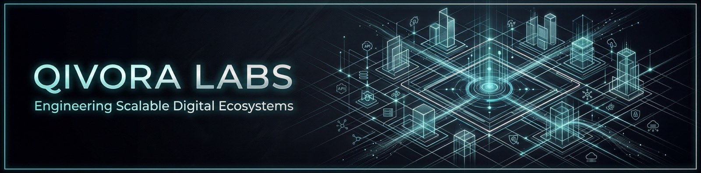

<div align="center">

  

  <h1>Qivora Labs</h1>

  <p>
    Qivora Labs is an autonomous software development studio and product foundry focused on building high-performance, edge-first SaaS products and localized workflow automation engines. We're building web apps, mobile apps, and custom systems —
or a dedicated engineering pod in your repo. Senior attention from day one.
  </p>

  <p>
    <a href="https://qivoralabs.com">Website</a>
    ·
    <a href="mailto:contact@qivoralabs.com">Email</a>
    ·
    <a href="https://www.linkedin.com/company/qivora-labs">LinkedIn</a>
  </p>

</div>

---

**Two ways to work with us**

1. **Application development** — product-grade web, mobile, and custom software, scoped and handed over for production.
2. **Dedicated engineering pods** — a senior squad in your repo and rituals, with real timezone overlap.

Cloud, data, and scoped AI when the product needs them — not as a separate catalogue.

**How we work**

Senior people stay on the delivery. Discovery before the expensive part. Working software every sprint, then a clean handover. You own the IP from the first commit.

```text
TypeScript · React · Next.js · React Native · Node.js · Go · PostgreSQL · AWS · GCP
```

---

<div align="center">

  <a href="https://qivoralabs.com/#contact">Start a conversation →</a>

  <br /><br />

  <sub>Remote · Dhaka, Bangladesh</sub>

</div>
